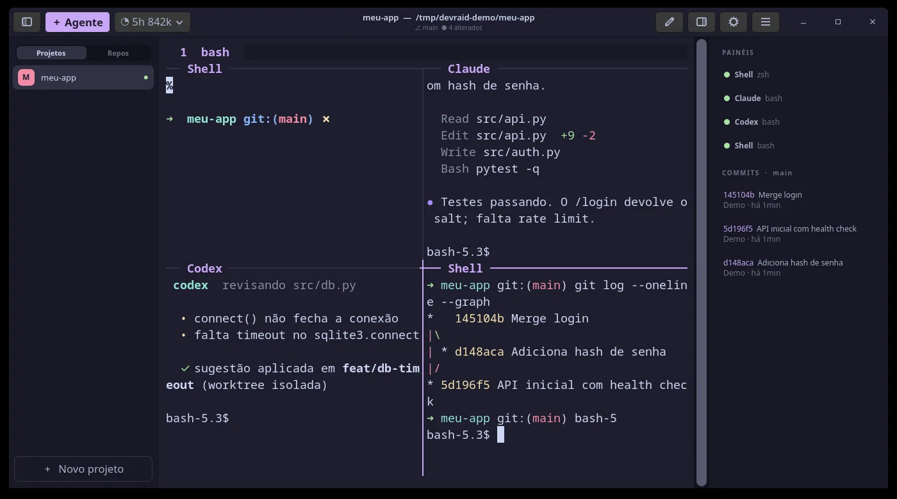

# /dev/raid

> Orquestre vários agentes de IA em terminais persistentes, um conjunto por projeto.
> *Run many AI coding agents side by side — one persistent terminal workspace per project (GTK4 + VTE + tmux).*

**[Documentação](https://kleber-code.github.io/dev-raid/)** · **[Guia completo](https://kleber-code.github.io/dev-raid/guia.html)** · MIT



Um "VS Code de terminais" para **orquestrar vários agentes de IA** (Claude Code, Codex, Aider…)
em paralelo, um conjunto de terminais por projeto, que **sobrevive** quando você fecha a janela
(tmux por baixo). GTK4 + VTE, feito em Python, pensado para Linux (sway/Wayland ou X11).

## O que faz

- **Projetos e Repos.** *Projetos* é o que você mexe; *Repos* lista **todos os seus repositórios do GitHub**
  (usuário + orgs, via `gh`). Abrir um repo o clona em `~/.raid_point/workspaces/<repo>` e o promove a projeto.
  Projetos exigem git.
- **Terminais persistentes.** Cada projeto é uma sessão tmux. Feche o app, volte, tudo continua lá.
- **Layouts claros:** colunas, linhas, grade, principal+lateral. Botão **＋ Agente** abre Claude/Codex/Aider/…
  num novo painel, opcionalmente em um **git worktree isolado** por agente.
- **Servidores remotos** (`~/.ssh/config`) via **mosh** ou ssh; o tmux roda na VPS.
- **Tarefa em paralelo e orquestrador:** a mesma tarefa em vários agentes, cada um na sua worktree, ou um Claude
  que divide o trabalho e abre subagentes pelo MCP. Você revisa em **Mudanças** (`Ctrl+G`); nada é mesclado sozinho.
- **Créditos:** percentual do plano (5 h e semana) do **Claude** e do **Codex**, saldo de créditos e tokens por projeto.
- **Painel de agentes** (`Ctrl+J`): painéis, sessões de IA e **subagentes** (via hooks do Claude Code),
  com status; clique abre o transcript.
- **MCP (`raidpoint mcp`)**: agentes listam/criam/mensageiam outros agentes, leem saída, usam **memória** e
  **segredos** do projeto.
- **Memória** por projeto em markdown + busca FTS5; entra no contexto ao iniciar uma sessão do Claude Code.
- **Segredos**: ficam no chaveiro do sistema. O agente só vê os *nomes*; para usar, você aprova num
  diálogo e o valor entra só no ambiente do comando (saída mascarada).
- **Git/PR** no título (branch, alterações, PR e checks via `gh`).

## Instalar

Em uma linha (detecta Arch, Fedora e Debian/Ubuntu, instala o que faltar e coloca o app em `~/.local`, sem root):

```bash
curl -fsSL https://kleber-code.github.io/dev-raid/install.sh | sh
# ou
wget -qO- https://kleber-code.github.io/dev-raid/install.sh | sh
```

Depois: `gh auth login` (uma vez), `devraid install` (registra hooks e MCP no Claude Code e no Codex) e `devraid` para abrir.
Rodar script da internet é confiar nele: [leia o install.sh](docs/install.sh) antes ou fixe uma versão com `DEVRAID_REF=v0.2.0`.
Para remover: `curl -fsSL https://kleber-code.github.io/dev-raid/install.sh | sh -s -- --uninstall`.

**Pacotes** (em [`packaging/`](packaging)): `PKGBUILD` para o AUR (`devraid` e `devraid-git`) e `devraid.spec` para RPM,
ambos prontos mas **ainda não publicados**. À mão: `sudo make install PREFIX=/usr/local`.

Dependências: Python 3.11+, GTK4, VTE 3.91 com PyGObject, tmux, `gh`, libsecret; `mosh` é opcional.

## Atalhos

Teclado e mouse (o prefixo do tmux é `Ctrl+a`):

| Ação | Tecla / gesto |
|---|---|
| Copiar / colar | `Ctrl+Shift+C` / `Ctrl+Shift+V` (ou `Ctrl+Insert` / `Shift+Insert`) |
| Copiar dentro do tmux | arrastar com o mouse (vai sozinho para a área de transferência) |
| Abrir link | `Ctrl+clique` |
| Menu do botão direito | copiar, colar, abrir link, dividir, zoom, mover para nova aba, fechar painel |
| Ocultar/mostrar projetos | `Ctrl+B` |
| Painel de agentes | `Ctrl+J` |
| **Ações** (paleta: agentes, painéis, layout, texto, config…) | `Ctrl+D` |
| **Configurações** (visual: fonte, tema, atalhos, agentes) | `Ctrl+,` |
| Ir para a aba N / trocar painel de lugar | `Alt+1…9` / `Alt+Shift+setas` |
| Mudanças / diff / commit | `Ctrl+G` |
| Zoom do texto | `Ctrl +` / `Ctrl −` / `Ctrl 0` / `Ctrl`+roda (configurável em `~/.raid_point/config.toml`) |
| Dividir lado a lado / embaixo | `Alt+\` / `Alt+-` |
| Nova aba / próxima / anterior | `Alt+t` / `Ctrl+PageDown` / `Ctrl+PageUp` |
| Fechar painel (pergunta antes) / zoom | `Alt+w` / `Alt+z` |
| Navegar entre painéis | `Alt+setas` |

O botão direito é do /dev/raid (e não do tmux ou do programa dentro do terminal), por isso funciona em qualquer painel.

## Sway

O sway cuida das janelas; o /dev/raid cuida de projetos/agentes. `app_id` = `br.com.satela.DevRaid`:

```
for_window [app_id="br.com.satela.DevRaid"] move to workspace 2
```

## Nomes internos

O app se chamava Raid Point. O comando é `devraid` (sem argumentos abre a janela; com um verbo é a CLI: `devraid ls`, `devraid mcp`…) e o `app_id` é `br.com.satela.DevRaid`. O comando antigo `raidpoint`, a pasta `~/.raid_point` e o servidor MCP `raidpoint` foram mantidos para não quebrar instalações existentes.

## Dados

Tudo em `~/.raid_point/`: `projects.json`, `agents.json` (presets do menu ＋ Agente), `tmux.conf`,
`workspaces/`, `data/` (eventos e memória).

## Segurança e limites (leia)

- `send_message` só entra direto em painéis de **agente** (aberto pelo /dev/raid, com o nome de um preset que
  não seja Shell). Qualquer outro painel (shell, ssh, python…) pede a sua aprovação.
- Os segredos ficam no chaveiro do sistema; as ferramentas MCP **nunca devolvem o valor** ao agente, e o
  `run_with_secrets` só roda depois da sua aprovação, com a saída mascarada (só mascara o valor exato, não
  versões codificadas dele).
- **Isso protege contra o uso pelas ferramentas MCP, não contra um agente com acesso a shell.** Um agente que roda
  comandos como o seu usuário consegue, em tese, ler o chaveiro direto (`secret-tool`) ou editar os arquivos de
  aprovação. Para uma barreira de verdade, rode os agentes sob outro usuário ou em sandbox.
- A memória do projeto entra no contexto de novas sessões: trate o que os agentes gravam nela como não confiável.
- Alerta de vazamento de segredo em logs: ainda não implementado.

## Desenvolvimento

- `RAIDPOINT_APPID` troca o ID do app (rodar uma 2ª instância de teste); `RAIDPOINT_SHOW=changes|palette|settings|parallel` abre uma janela ao iniciar; `RAIDPOINT_HOME` muda a pasta de dados e `RAIDPOINT_SOCKET` o socket do tmux, para testar sem tocar no uso real.
- Os nomes de sessão do tmux trocam `.` e `:` por `_` e os alvos usam `=nome:` (casamento exato, não por prefixo).
- `projects.json` é gravado com trava e de forma atômica; se estiver ilegível, o app se recusa a sobrescrevê-lo.
